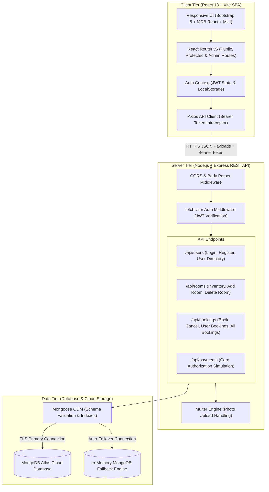

# Functional Specification Document (FSD)
## HotelPro — Luxury Hotel Management & Booking System

---

## 1. Document Control & Metadata

| Field | Specification |
|---|---|
| **Project Title** | HotelPro — Hotel Booking & Management Platform |
| **Document Type** | Functional Specification Document (FSD) |
| **Version** | 1.0.0 |
| **Status** | Production Ready / Deployed |
| **Author** | Senior Full-Stack Engineering Team |
| **Architecture** | Client-Server Decoupled MERN Architecture |
| **Repository** | `https://github.com/rupalichouhan/HotelPro.git` |
| **Frontend Deployment** | Vercel (Edge CDN) — `https://hotel-pro-ten.vercel.app` |
| **Backend Deployment** | Render Web Service — `https://hotelpro-api.onrender.com` |
| **Database** | MongoDB Atlas (Cloud Tier M0) |

---

## 2. Executive Summary & Problem Statement

### 2.1 Problem Statement
Traditional hospitality and hotel reservation systems frequently suffer from:
1. **Disconnected Customer Experience:** Friction in viewing real-time room availability, complex check-in/check-out date selection, and ambiguous pricing.
2. **Double-Booking & Inventory Overlap:** Lack of robust server-side concurrency checking during booking creation, leading to inventory conflicts.
3. **Opaque Administrative Oversight:** Difficulty for hotel managers to view active reservations, manage multi-tier room inventory, and audit registered accounts from a centralized interface.
4. **Weak Access Segmentation:** Failure to strictly separate customer reservation workflows from administrative inventory and user management operations.

### 2.2 Solution Overview
**HotelPro** is a modern full-stack hotel management platform engineered to resolve these challenges. It provides:
- A responsive, customer-facing single-page application (SPA) with a luxury hero showcase, instant date availability calculator, category filtering, interactive booking modal, and integrated card payment simulation.
- A dedicated customer reservation center (`My Bookings`) enabling guests to track their stay dates, verify invoice totals, and cancel reservations in real time.
- A secure administrative dashboard (`AdminHome`) built with tab-based navigation (`MDBTabs`) providing live KPI metrics, comprehensive booking oversight, room creation/deletion, and user account management.
- A robust Express.js REST API with Mongoose Object Data Modeling, JWT token-based authentication, salted password encryption (`bcryptjs`), and automated in-memory database fallback to ensure 100% operational uptime.

---

## 3. High-Level System Architecture

### 3.1 Architectural Flow Diagram



### 3.2 Tier Responsibilities

1. **Presentation Tier (`client/`):**
   - Built with React 18 and Vite for near-instant hot module reloading and optimized production bundles.
   - Handles route protection via `<ProtectedRoute>` (for registered guests) and `<AdminRoute>` (for hotel staff/administrators).
   - Manages asynchronous API calls and attaches authentication tokens using Axios interceptors.
   - Provides user feedback via `react-toastify` notifications and interactive modal windows.

2. **Application Tier (`server/`):**
   - Built with Node.js and Express.js in a modular architecture (`routes/`, `models/`, `middleware/`).
   - Validates incoming request payloads, hashes credentials with `bcryptjs`, issues JSON Web Tokens, and verifies access permissions.
   - Contains business logic to calculate stay duration, compute pricing, and perform conflict-free reservation scheduling.

3. **Data Tier (MongoDB):**
   - Mongoose schemas enforce data integrity, unique constraints, and schema-level validation.
   - Primary data store is hosted on MongoDB Atlas with high-availability replication.
   - Seamless embedded in-memory database (`mongodb-memory-server`) triggers automatically in local/development environments if external connectivity is offline.

---

## 4. User Personas & Role-Based Access Control (RBAC)

### 4.1 User Personas

| Persona | Role Identifier | Description |
|---|---|---|
| **Public Visitor** | Unauthenticated | Potential guest browsing luxury hotel rooms, reviewing amenities, and viewing rates. |
| **Registered Customer** | `customer` | Verified guest with an account who can check live dates, book rooms, simulate payments, and manage reservations. |
| **System Administrator** | `admin` | Hotel manager or operations staff with permissions to oversee all reservations, manage room inventory, and audit user records. |

### 4.2 Permissions Matrix

| Feature / Action | Public Visitor | Registered Customer | System Administrator |
|---|:---:|:---:|:---:|
| **View Landing Page & Hero Showcase** | Yes | Yes | Yes |
| **Browse Room Catalog & Amenities** | Yes | Yes | Yes |
| **Filter by Room Category & Keyword** | Yes | Yes | Yes |
| **Filter Rooms by Date Availability** | Yes | Yes | Yes |
| **User Sign Up & Login** | Yes | Yes | Yes |
| **Reserve a Room (Interactive Booking Modal)** | No | Yes | Yes |
| **Execute Simulated Payment** | No | Yes | Yes |
| **View Self Booking History (`My Bookings`)** | No | Yes | Yes |
| **Cancel Self Booking** | No | Yes | Yes |
| **Access Admin Dashboard (`/admin`)** | No | No | Yes |
| **View KPI Operations Metrics Ribbon** | No | No | Yes |
| **View All System Bookings** | No | No | Yes |
| **Cancel Any Guest Reservation** | No | No | Yes |
| **Add New Room to Inventory** | No | No | Yes |
| **Delete Room from Inventory** | No | No | Yes |
| **View All Registered Users Directory** | No | No | Yes |

### 4.3 Route Guard Architecture

```text
Incoming Request -> React Router (App.jsx)
   │
   ├── Public Routes (/, /rooms, /login, /signup) ─────> Render Target Component
   │
   ├── Customer Routes (/home, /mybookings)
   │     └── <ProtectedRoute>
   │           ├── Is Authenticated? ─> YES ───────────> Render Target Component
   │           └── Is Authenticated? ─> NO  ───────────> Redirect to /login (preserve location state)
   │
   └── Admin Routes (/admin)
         └── <AdminRoute>
               ├── Is Authenticated & role === 'admin'? ─> YES ─> Render Admin Dashboard
               ├── Is Authenticated & role !== 'admin'? ─> NO  ─> Redirect to /home
               └── Not Authenticated? ─────────────────> NO  ─> Redirect to /login
```

---

## 5. Functional Requirements & Feature Breakdown

### 5.1 Module 1: Authentication & Identity Management
- **User Registration (`/api/users/SignUp`):**
  - Accepts `name`, `email`, `password`, `c_password`, `phone`, and `type` (`customer` or `admin`).
  - Validates all mandatory fields and verifies that `password === c_password`.
  - Enforces minimum 6-character password constraint and email uniqueness.
  - Generates cryptographic salt via `bcryptjs.genSalt(10)` and securely stores the hashed password.
  - Automatically generates a unique user identifier (e.g., `USR_XXXXXX`).
  - Returns a signed JWT token valid for 7 days alongside sanitized user profile data.
- **User Authentication (`/api/users/Login`):**
  - Accepts `email` and `password`.
  - Verifies email existence and compares passwords using `bcryptjs.compare()`.
  - Issues a signed JWT payload: `{ user: { id, user_id, name, email, phone, type } }`.
  - Offers **One-Click Demo Credentials** on the frontend for instant recruiter and evaluator testing.
- **Session State & Persistence:**
  - `AuthContext.jsx` maintains user state in React memory and syncs with `localStorage`.
  - Custom Axios interceptor automatically appends `auth-token` and `Authorization: Bearer <token>` to protected HTTP calls.
  - One-click logout cleanly purges local storage and resets global state.

### 5.2 Module 2: Room Inventory & Discovery Engine
- **Visual Presentation:**
  - Responsive Hero Carousel showcasing premium suites, infinity pool amenities, and guest hospitality services.
  - Grid of interactive room cards featuring room number, category badge, nightly price, capacity badge, description snippet, and quick amenity icons.
  - "View Details" modal rendering a secondary multi-image carousel, complete amenities list, and full architectural description.
- **Availability Search & Overlap Prevention:**
  - Date pickers for **Check-in Date** (`fromdate`) and **Check-out Date** (`todate`).
  - Category selector filtering across `Deluxe`, `Super Deluxe`, `Suite`, `Family Suite`, `Standard`, and `Executive`.
  - Real-time client-side and server-side overlap detection:
    $$\text{Conflict Condition: } (\text{RequestedStart} < \text{BookingEnd}) \land (\text{RequestedEnd} > \text{BookingStart})$$
  - If active overlapping bookings meet or exceed the room's total capacity unit count (`count`), the room is flagged as unavailable.

### 5.3 Module 3: Booking & Payment Processing Workflow
- **Interactive Booking Modal (`BookingModal.jsx`):**
  - Displays selected room summary, unit rate, and guest details.
  - Allows date adjustment with dynamic calculation of stay duration and total cost:
    $$\text{totaldays} = \left\lceil \frac{\text{todate} - \text{fromdate}}{86,400,000 \text{ ms}} \right\rceil$$
    $$\text{totalAmount} = \text{totaldays} \times \text{room.rent}$$
- **Simulated Payment Gateway:**
  - Accepts `cardholdername`, `cardNumber` (16 digits formatted in groups of 4), `expmonthyear` (MM/YY), and `cvvcode` (3 or 4 digits).
  - Routes through `/api/payments/pay` to simulate financial authorization and generate a verifiable transaction ID (`TXN_XXXXXXXXXXXXX`).
  - Strictly sandboxed demonstration: Does not charge live bank accounts.
- **Reservation Finalization (`/api/bookings/bookroom`):**
  - Generates unique reservation code: `BK_XXXXXX`.
  - Persists booking document with status `booked`.
  - Stores payment card reference linked to the booking.
  - Updates the target Room document by pushing `{ booking_id, fromdate, todate, user_id, status: 'booked' }` into its `currentBookings` array.
  - Displays a toast success alert and directs the user to `My Bookings`.

### 5.4 Module 4: Customer Reservation Center (`My Bookings`)
- **Reservation Directory:**
  - Queries `/api/bookings/getbookingsbyuserid` using the authenticated guest's `user_id`.
  - Displays reservation cards with Reservation ID, Room Reference, Check-in / Check-out stay dates, duration (nights), total paid, and status badge (`Confirmed` vs `Cancelled`).
- **Cancellation Engine:**
  - Active confirmed bookings feature an active **Cancel Booking** button.
  - Opens a confirmation dialog warning the user before cancellation.
  - Submits request to `/api/bookings/cancelbooking`.
  - Server updates Booking status to `cancelled` and removes the booking record from the Room's `currentBookings` array, immediately releasing the room inventory for other guests.

### 5.5 Module 5: Administrator Operations Portal (`AdminHome`)
- **KPI Metrics Ribbon:**
  - **Total Reservations:** Real-time count of all bookings across the platform.
  - **Inventory Units:** Total count of active suites in the system.
  - **Gross Revenue:** Real-time summation of all non-cancelled booking transaction totals ($).
  - **Registered Accounts:** Total number of registered customers and administrators.
- **Tab-Based Interface (`MDBTabs`):**
  1. **All Bookings Tab:**
     - Data table displaying Booking ID, Room Number, Guest Name, User ID, Date Range, Total Days, Total Amount, and Status.
     - Search filter to query reservations by Booking ID, Guest Name, or Room Number.
     - Direct administrative cancellation control for any active reservation.
  2. **All Rooms Tab:**
     - Inventory data table displaying room thumbnails, room numbers, category badges, nightly pricing, capacity, and active reservations count.
     - Action button to delete rooms from the catalog with confirmation prompt.
  3. **Add Room Tab:**
     - Form to publish new accommodations into the database.
     - Inputs: Room Number, Room Category dropdown, Nightly Rent ($), Capacity Units, Detailed Description, and Photo URLs (comma/newline separated).
     - Full support for Multer file uploads (`multipart/form-data`) or CDN image URL lists.
  4. **All Users Tab:**
     - System user registry displaying User ID, Avatar, Full Name, Email Address, Contact Phone, Account Role badge (`Admin` vs `Customer`), and Registration Date.
     - Search filter to query users by name, email, or telephone.

---

## 6. Entity Data Models (Database Schema Specifications)

### 6.1 User Entity (`server/models/userModel.js`)

| Field Name | BSON Type | Constraints | Description |
|---|---|---|---|
| `_id` | ObjectId | Auto-generated, Primary Key | Unique MongoDB document identifier |
| `user_id` | String | Unique, Default: `USR_XXXXXX` | Human-readable user reference identifier |
| `name` | String | Required, Trimmed | Full legal name of user |
| `email` | String | Required, Unique, Lowercase | User account email address (used for login) |
| `password` | String | Required | 60-character bcrypt salted password hash |
| `c_password` | String | Optional | Password confirmation verification flag |
| `phone` | String | Required, Trimmed | Primary contact telephone number |
| `type` | String | Enum: `['admin', 'customer']`, Default: `'customer'` | Role authorization classifier |
| `createdAt` | Date | Auto-generated Timestamp | Record creation timestamp |
| `updatedAt` | Date | Auto-generated Timestamp | Record last modification timestamp |

### 6.2 Room Entity (`server/models/roomModel.js`)

| Field Name | BSON Type | Constraints | Description |
|---|---|---|---|
| `_id` | ObjectId | Auto-generated, Primary Key | Unique MongoDB document identifier |
| `room_id` | String | Unique, Default: `RM_XXXX` | Internal room code reference |
| `roomNumber` | String | Required, Unique, Trimmed | Physical room unit number (e.g., "101", "301") |
| `type` | String | Required, Trimmed | Category: Deluxe, Super Deluxe, Suite, etc. |
| `rent` | Number | Required, Min: 0 | Nightly rental rate ($ USD) |
| `count` | Number | Required, Min: 1, Default: 1 | Number of available physical units/capacity |
| `description`| String | Required | Overview of room furnishings, views, amenities |
| `photos` | Array [String] | Required, Default: `[]` | Array of high-resolution image asset URLs |
| `currentBookings` | Array [Object] | Default: `[]` | Active booking range snapshots (see sub-schema below) |
| `createdAt` | Date | Auto-generated Timestamp | Record creation timestamp |
| `updatedAt` | Date | Auto-generated Timestamp | Record last modification timestamp |

**Embedded Sub-Schema: `currentBookings`:**
```json
{
  "booking_id": "String (Required)",
  "fromdate": "String (Required, e.g. 'YYYY-MM-DD')",
  "todate": "String (Required, e.g. 'YYYY-MM-DD')",
  "user_id": "String (Required)",
  "status": "String (Default: 'booked')"
}
```

### 6.3 Booking Entity (`server/models/bookingModel.js`)

| Field Name | BSON Type | Constraints | Description |
|---|---|---|---|
| `_id` | ObjectId | Auto-generated, Primary Key | Unique MongoDB document identifier |
| `booking_id` | String | Required, Unique, Default: `BK_XXXXXX` | Public customer reservation confirmation code |
| `room_id` | String | Required | Target Room reference identifier |
| `user_id` | String | Required | Customer User reference identifier |
| `name` | String | Required, Trimmed | Primary guest name on reservation |
| `fromdate` | String | Required | Check-in calendar date |
| `todate` | String | Required | Check-out calendar date |
| `totaldays` | Number | Required, Min: 1 | Duration of stay in nights |
| `totalAmount` | Number | Required, Min: 0 | Total invoice amount charged ($ USD) |
| `status` | String | Enum: `['booked', 'cancelled']`, Default: `'booked'` | Reservation status flag |
| `createdAt` | Date | Auto-generated Timestamp | Record creation timestamp |
| `updatedAt` | Date | Auto-generated Timestamp | Record last modification timestamp |

### 6.4 CardDetails Entity (`server/models/cardModel.js`)

| Field Name | BSON Type | Constraints | Description |
|---|---|---|---|
| `_id` | ObjectId | Auto-generated, Primary Key | Unique MongoDB document identifier |
| `booking_id` | String | Required | Reservation reference identifier |
| `user_id` | String | Optional | Customer User reference identifier |
| `cardNumber` | String | Required | Payment card digits (simulated sandbox token) |
| `cvvcode` | String | Required | Security verification code |
| `expmonthyear` | String | Required | Card expiration format (`MM/YY`) |
| `cardholdername` | String | Required | Name on payment instrument |
| `createdAt` | Date | Auto-generated Timestamp | Record creation timestamp |
| `updatedAt` | Date | Auto-generated Timestamp | Record last modification timestamp |

---

## 7. RESTful API Endpoints Directory

| HTTP Verb | Endpoint Path | Access Level | Description | Expected Request Body | Expected Response Status & Payload |
|---|---|---|---|---|---|
| `GET` | `/` | Public | System Health Check | None | `200 OK` `{ status, system, version, endpoints }` |
| `POST` | `/api/users/SignUp` | Public | Register new account | `{ name, email, password, c_password, phone, type }` | `201 Created` `{ success: true, token, user }` |
| `POST` | `/api/users/Login` | Public | Authenticate user | `{ email, password }` | `200 OK` `{ success: true, token, user }` |
| `GET` | `/api/users/getuser` | Authenticated | Fetch current profile | None (reads `Bearer` token) | `200 OK` `{ success: true, user }` |
| `GET` | `/api/users/getallusers` | Admin | Directory of all users | None | `200 OK` `{ success: true, count, users: [...] }` |
| `GET` | `/api/rooms/getallrooms` | Public | Catalog of all rooms | None | `200 OK` `{ success: true, count, rooms: [...] }` |
| `GET` | `/api/rooms/getroombyid/:id` | Public | Get single room detail | None (URL parameter `:id`) | `200 OK` `{ success: true, room: {...} }` |
| `POST` | `/api/rooms/addroom` | Admin | Publish new room | `{ roomNumber, type, rent, count, description, photos }` | `201 Created` `{ success: true, room: {...} }` |
| `DELETE` | `/api/rooms/deleteroom/:id` | Admin | Delete room inventory | None (URL parameter `:id`) | `200 OK` `{ success: true, message: 'Room deleted' }` |
| `POST` | `/api/bookings/bookroom` | Authenticated | Create reservation | `{ room_id, user_id, name, fromdate, todate, totaldays, totalAmount, cardDetails }` | `201 Created` `{ success: true, booking: {...} }` |
| `POST` | `/api/bookings/cancelbooking` | Authenticated | Cancel reservation | `{ booking_id, room_id }` | `200 OK` `{ success: true, booking: {...} }` |
| `POST` | `/api/bookings/getbookingsbyuserid`| Authenticated | Get user's bookings | `{ user_id }` | `200 OK` `{ success: true, count, bookings: [...] }` |
| `GET` | `/api/bookings/getallbookings` | Admin | Master booking registry| None | `200 OK` `{ success: true, count, bookings: [...] }` |
| `POST` | `/api/payments/pay` | Public/Auth | Card payment simulation | `{ cardNumber, cvvcode, expmonthyear, cardholdername, amount }` | `200 OK` `{ success: true, transactionId, amount }` |

---

## 8. Security, Operational & Non-Functional Specifications

### 8.1 Cryptography & Credential Protection
- **One-Way Password Hashing:** User passwords undergo salted hashing using `bcryptjs` with a cost work factor of 10. Raw passwords are never stored in the database.
- **Token Verification:** JSON Web Tokens (`jsonwebtoken`) are cryptographically signed using an environment secret key (`JWT_SECRET`) and expire after 7 days.
- **Middleware Validation:** Requests targeting protected endpoints must pass through [`fetchUser.js`](file:///C:/Users/prade/OneDrive/Desktop/HotelPro/server/middleware/fetchUser.js), which validates token structure and signature before assigning `req.user`.

### 8.2 CORS Governance
- Origin validation is enforced via the `cors` middleware package.
- Authorized development and production origins:
  - `http://localhost:5173` (Vite Local Dev)
  - `http://127.0.0.1:5173` (Vite Local Alternate)
  - `http://localhost:3000` (Legacy Port Support)
  - `https://hotel-pro-ten.vercel.app` (Vercel Production Domain)
  - Dynamic environment resolution via `process.env.FRONTEND_URL`.

### 8.3 Zero-Crash In-Memory Database Fallback
- In [`server/db.js`](file:///C:/Users/prade/OneDrive/Desktop/HotelPro/server/db.js), if the primary database connection to MongoDB Atlas or local daemon times out (2500ms limit), the system automatically launches an embedded in-memory MongoDB instance (`MongoMemoryServer`).
- Automatically triggers [`server/initSeed.js`](file:///C:/Users/prade/OneDrive/Desktop/HotelPro/server/initSeed.js) to populate initial demo rooms, administrators, and customer accounts, ensuring uninterrupted demonstrations during evaluator walkthroughs.

### 8.4 Single Page Application (SPA) Deep-Routing
- To prevent 404 HTTP errors upon refreshing non-root routes (`/home`, `/mybookings`, `/admin`) on Vercel, a [`vercel.json`](file:///C:/Users/prade/OneDrive/Desktop/HotelPro/client/vercel.json) rewrite rule redirects all incoming requests back to `/index.html`:
  ```json
  {
    "rewrites": [
      { "source": "/(.*)", "destination": "/index.html" }
    ]
  }
  ```

---

## 9. Environment Variables Specification

### 9.1 Server Configuration (`server/.env`)

| Variable Name | Required | Default / Fallback | Purpose |
|---|:---:|---|---|
| `PORT` | No | `8001` | Local port on which Express server listens |
| `MONGODB_URI` | Yes | `mongodb://localhost:27017/hotel` | MongoDB Atlas connection string (TLS authenticated) |
| `JWT_SECRET` | Yes | System generated key | Secret key for signing and verifying authentication tokens |
| `FRONTEND_URL` | No | `https://hotel-pro-ten.vercel.app` | Production frontend domain for CORS allowlisting |

### 9.2 Client Configuration (`client/.env`)

| Variable Name | Required | Default / Fallback | Purpose |
|---|:---:|---|---|
| `VITE_API_BASE_URL` | Yes | `http://localhost:8001/api` | Base HTTP endpoint URL for backend REST API requests |

---

## 10. Git Publishing & Terminal Push Guide

Follow this sequence in VS Code or Terminal to commit and push this document and all project updates to your GitHub repository:

### Step 1: Open Terminal in Project Root
```bash
cd "C:\Users\prade\OneDrive\Desktop\HotelPro"
```

### Step 2: Check Current Git Status
```bash
git status
```
*You will see `FSD.md` (or `fsd.md`) listed as modified or untracked.*

### Step 3: Stage the FSD Document
```bash
git add FSD.md
```
*(Or use `git add .` to stage all project files).*

### Step 4: Commit with a Standard Semantic Message
```bash
git commit -m "docs: add comprehensive Functional Specification Document (FSD)"
```

### Step 5: Verify Remote Destination
```bash
git remote -v
```
*Expected output: `origin https://github.com/rupalichouhan/HotelPro.git (push)`*

### Step 6: Push to GitHub
```bash
git push origin main
```

---

*End of Functional Specification Document (FSD) — HotelPro Management System.*
